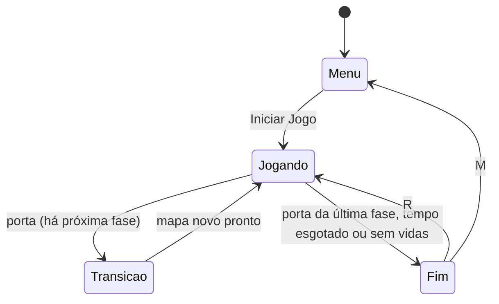

# Jogo Intro

Jogo 2D feito em **Unity 6** em que o jogador controla uma bola e precisa atravessar **dois labirintos**: em cada um, **coletar todos os itens** para abrir a **porta de saída** antes que o tempo acabe, desviando de inimigos.

## Como jogar

Ao abrir o jogo aparece o **menu inicial**, com as opções **Iniciar Jogo** e **Regras**. Os botões funcionam com o mouse ou com as setas + Enter.

| Tecla | Ação |
|---|---|
| **W A S D** ou **setas** | Mover o jogador |
| **R** | Jogar novamente (na tela de fim de partida) |
| **M** | Voltar ao menu (na tela de fim de partida) |

- A partida começa com **45 segundos**, em contagem regressiva.
- Cada item coletado dá **+3 segundos**.
- A **porta** de cada fase começa trancada (marrom) e abre (verde, pulsando) quando todos os itens da fase são coletados. Entrar nela leva à próxima fase (com uma transição: a tela escurece, mostra o nome da fase e clareia no mapa novo) e dá **+30 segundos**. Vida e cronômetro continuam de uma fase para a outra.
- O jogador tem **5 corações**, mostrados no canto superior direito.
- Encostar em um inimigo tira **1 coração e 5 segundos**. O jogador é empurrado e fica invencível (piscando) por 1,5 s.
- **3 corações** espalhados pelo mapa recuperam 1 vida cada. Com a vida cheia eles não são consumidos e ficam no mapa para depois.
- **Vitória:** passar pela porta da última fase. **Derrota:** o tempo chegar a zero ou os corações acabarem.
- Ao final aparece o tempo da partida e o **melhor tempo** (recorde), que fica salvo entre sessões.

### Inimigos

| Comportamento | Descrição |
|---|---|
| **Parado** | Obstáculo imóvel |
| **Patrulha** | Vai e volta em uma direção pré-definida |
| **Perseguição** | Segue o jogador o tempo todo |
| **Sentinela** | Patrulha até o jogador chegar perto, muda de cor e passa a persegui-lo. Volta a patrulhar quando o jogador se afasta |

Os inimigos seguem os corredores do labirinto: o perseguidor e a sentinela encontram o caminho até o jogador sem atravessar paredes.

## Como executar

1. Abra a pasta do projeto no **Unity Hub** (versão 6000.6 ou compatível).
2. Abra a cena `Assets/Scenes/SampleScene`.
3. Clique em **Play**.

O `GameManager`, o menu, a interface e o labirinto são criados automaticamente ao iniciar a cena. Os valores de tempo podem ser ajustados pelo Inspector.

### Prefabs

Itens, corações e inimigos são **prefabs** em `Assets/Resources/Prefabs/`, criados pelas fábricas ao montar a fase. Para mudar velocidade, raios de detecção, direção da patrulha ou cor de um tipo de inimigo, basta abrir o prefab dele e editar no Inspector:

| Símbolo | Prefab | Sprite |
|---|---|---|
| `I` | `Item` | triângulo amarelo |
| `C` | `Coracao` | coração |
| `E` | `InimigoParado` | jacaré |
| `H` | `InimigoPatrulhaHorizontal` | arara azul |
| `V` | `InimigoPatrulhaVertical` | arara azul |
| `S` | `InimigoSentinela` | tubarão destemido |
| `F` | `InimigoPerseguidor` | leão |

O jogador é a raposinha (`Assets/sprites/player/`); os sprites dos inimigos ficam em `Assets/sprites/enemy/`.

Eles ficam em uma pasta `Resources` porque o `GameManager` e as fábricas são criados por código e não recebem referências pelo Inspector; assim o código encontra cada prefab pelo nome.

### Editando o labirinto

As fases são desenhos em texto no arquivo `Assets/Scripts/Level/MapaFase.cs`. Cada caractere é uma célula de 0,5 x 0,5 unidade:

| Símbolo | Significado | Símbolo | Significado |
|---|---|---|---|
| `#` | parede | `.` | chão |
| `P` | início do jogador | `I` | item amarelo |
| `C` | coração (vida) | `E` | inimigo parado |
| `H` | patrulha horizontal | `V` | patrulha vertical |
| `S` | sentinela | `F` | perseguidor |
| `D` | porta de saída | | |

Para mudar uma fase, basta redesenhar o texto (todas as linhas com o mesmo tamanho). Para criar uma fase nova, desenhe outro mapa e adicione-o à lista `MapaFase.Fases`: a porta da fase anterior passa a levar até ela. Patrulhas e sentinelas andam de uma parede até a outra no corredor onde foram desenhadas. Os itens já colocados na cena são movidos para as posições `I` da primeira fase; os que faltarem (e os das fases seguintes) são criados a partir do prefab `Item`.

O labirinto só é montado ao dar Play, mas a aba **Scene** mostra uma pré-visualização dele no editor (paredes e marcadores com a letra de cada símbolo). Ela pode ser ligada e desligada no menu **Jogo Intro → Pré-visualizar labirinto**, e **Jogo Intro → Pré-visualizar próxima fase** alterna entre as fases.

## Estrutura do código

Os scripts ficam em `Assets/Scripts/`, organizados **por funcionalidade**: cada pasta reúne tudo de uma parte do jogo. Os prefabs e o sprite do coração ficam em `Assets/Resources/` e a cena em `Assets/Scenes/`. (`Assets/Welcome/` é do template 2D da Unity e não faz parte do jogo.)

```
Assets/Scripts/
├── Core/           base compartilhada: interfaces, Vida e utilitários (não depende de nenhuma outra pasta)
├── Game/           regras e estados da partida (GameManager)
├── Inicializacao/  monta o GameManager, as telas e o jogador ao carregar a cena
├── Player/         movimento e reação a dano do jogador
├── Enemies/        os inimigos
│   └── Comportamentos/   as estratégias de movimento (uma por arquivo)
├── Items/          os itens coletáveis
├── Level/          o labirinto: desenho, montagem, porta e busca de caminho
├── UI/             as telas e a interface
└── Editor/         ferramentas do editor (não vão para o jogo final)
```

**Direção das dependências:** `Core` é a base e não conhece ninguém. `Game` (o `GameManager`) orquestra jogador, fase e itens, mas **não conhece as telas**. A `UI` só observa o `Game`. O `Inicializacao` é o único que conhece todo mundo, porque é ele que junta as peças, e nenhuma outra pasta depende dele.

| Pasta | Arquivo | Responsabilidade |
|---|---|---|
| `Core/` | `Vida.cs` | Pontos de vida (corações) de um objeto |
| `Core/` | `IDanificavel.cs` | Interface para objetos que podem levar dano |
| `Core/` | `ITransicaoFase.cs` | Interface da animação de troca de fase |
| `Core/` | `SpriteFactory.cs` | Sprites geométricos gerados por código (quadrado das paredes e porta) |
| `Core/` | `Recursos.cs` | Carrega prefabs e sprites da pasta `Resources` pelo nome |
| `Core/` | `OrdemDesenho.cs` | Ordem de desenho dos sprites (o que fica por cima) |
| `Core/` | `ExtensoesComponente.cs` | `ObterOuAdicionar<T>()`: pega um componente ou o adiciona se faltar |
| `Game/` | `GameManager.cs` | Regras e estados da partida: cronômetro, contagem regressiva, itens, vidas, fases, vitória/derrota e recorde |
| `Game/` | `EstadoJogo.cs`, `MotivoFim.cs`, `ResultadoPartida.cs` | Tipos usados pelo `GameManager` (estados, motivo do fim e dados da tela final) |
| `Inicializacao/` | `InicializadorJogo.cs` | Cria o `GameManager` e as telas e completa o jogador com o componente de dano |
| `Player/` | `PlayerMovement.cs` | Movimento do jogador (teclado, física, empurrão) |
| `Player/` | `DanoJogador.cs` | Reação a dano: perde coração, é empurrado e fica invencível piscando |
| `Enemies/` | `Enemy.cs` | Configuração do inimigo e dano ao jogador |
| `Enemies/` | `EnemyFactory.cs` | Cria inimigos a partir dos prefabs (um por símbolo do mapa) |
| `Enemies/Comportamentos/` | `IComportamentoInimigo.cs` e `Comportamento*.cs` | As estratégias de movimento: parado, patrulha, perseguição e sentinela |
| `Items/` | `ItemColetavel.cs` | Item amarelo: avisa o `GameManager` ao ser coletado |
| `Items/` | `CoracaoColetavel.cs` | Item que recupera 1 coração |
| `Items/` | `ItemFactory.cs` | Cria corações e itens a partir dos prefabs |
| `Level/` | `MapaFase.cs` | Desenho das fases em texto |
| `Level/` | `ConstrutorFase.cs` | Monta a fase a partir do desenho (paredes, jogador, itens, corações, porta e inimigos) |
| `Level/` | `Porta.cs` | Porta de saída: abre quando os itens acabam e leva à próxima fase |
| `Level/` | `Labirinto.cs` | Grade do labirinto e busca de caminho (BFS) para os inimigos |
| `UI/` | `MenuInicial.cs` | Menu inicial (Iniciar Jogo / Regras) |
| `UI/` | `GameHUD.cs` | Interface durante a partida (tempo, itens, corações, tela final) |
| `UI/` | `TransicaoFase.cs` | Animação de troca de fase (escurecer, cartão "Fase N", clarear) |
| `UI/` | `UIFactory.cs` | Criação dos elementos de interface (canvas, textos, painéis, botões) |
| `Editor/` | `PreviewFase.cs` | Pré-visualização do labirinto na aba Scene |

## Design patterns

| Padrão | Onde | Para que serve |
|---|---|---|
| **Singleton** | `GameManager` | Um único gerenciador da partida, acessível por `GameManager.Instance` |
| **Observer** | `GameManager`, `Vida` | Avisam por eventos o que aconteceu; telas e porta só reagem |
| **Máquina de estados** | `GameManager` | Define o que pode acontecer em cada momento da partida |
| **Strategy** | `Enemies/Comportamentos/` | Cada forma de o inimigo se mover é uma classe trocável |
| **Null Object** | `ComportamentoParado` | Um comportamento que não faz nada, para evitar checagens de `null` |
| **Factory** | `EnemyFactory`, `ItemFactory`, `UIFactory`, `SpriteFactory` | Concentram em um lugar o "como criar" cada tipo de objeto |
| **Builder** | `ConstrutorFase` | Monta a fase passo a passo a partir do desenho em texto |
| **Interfaces** | `IDanificavel`, `ITransicaoFase` | Quem usa depende do contrato, não da classe concreta |

### Singleton
Existe um único `GameManager`. Jogador, inimigos, itens e porta o avisam do que aconteceu (item coletado, dano, porta) por `GameManager.Instance`, sem precisar guardar referências.

### Observer
O `GameManager` não mexe na tela: ele dispara eventos e quem se interessa reage.

| Evento | Quem reage |
|---|---|
| `PartidaIniciada` | Menu se esconde, HUD aparece |
| `TempoAlterado` | HUD mostra "+3s" ou "-5s" |
| `ItensConcluidos` | Porta abre, HUD mostra "A porta abriu!" |
| `FaseIniciada` | Tela de transição mostra "Fase N" |
| `PartidaTerminou` | HUD mostra a tela de fim de jogo |
| `Vida.VidaAlterada` | HUD redesenha os corações |
| `Vida.Morreu` | `GameManager` encerra a partida |

Assim as regras do jogo não dependem da interface, que pode ser trocada sem mexer nelas.

### Máquina de estados
A partida está sempre em um destes estados (`EstadoJogo`). Fora de `Jogando`, o jogo fica congelado.



### Strategy e Null Object
O `Enemy` não sabe *como* se mover: ele recebe uma estratégia (`IComportamentoInimigo`) conforme a opção do Inspector e a executa a cada frame. A `ComportamentoSentinela` reaproveita as estratégias de patrulha e perseguição. A `ComportamentoParado` é um Null Object: não faz nada, mas evita tratar "sem comportamento" como caso especial. Para criar um comportamento novo, basta escrever outra classe.

### Factory e Builder
O `ConstrutorFase` (Builder) lê o desenho do `MapaFase` e decide **o que** vai em cada lugar; as fábricas sabem **como** criar cada objeto: inimigos e itens a partir dos prefabs, telas e sprites por código. Por isso, mudar o labirinto não exige mexer em código, só no desenho, e ajustar um inimigo é só editar o prefab dele.

### Interfaces
- **`IDanificavel`**: o inimigo causa dano a qualquer objeto que implemente a interface (no jogador, o `DanoJogador`), sem conhecer o jogador.
- **`ITransicaoFase`**: o `GameManager` decide *quando* escurecer, trocar o mapa e clarear; *como* a tela é animada fica com a `TransicaoFase`. Sem ela, a troca de fase continua funcionando, só que instantânea.

### Outras decisões
- **Responsabilidade única:** o jogador é dividido em `PlayerMovement` (movimento), `DanoJogador` (dano) e `Vida` (corações), e cada item cuida da própria coleta.
- **Composition root:** o `InicializadorJogo` é o único que cria e liga as peças (`GameManager`, telas e componentes do jogador). Assim o `GameManager` não depende da interface.
- **Busca de caminho (BFS):** os inimigos pedem ao `Labirinto` o próximo passo pelos corredores, para não atravessar paredes.

## Créditos

- **Sprites dos personagens** (raposinha, arara azul, jacaré, leão e tubarão, em `Assets/sprites/`): os sprites foram reaproveitados do Projeto Pygame de 2024.2 de Ciência da Computação.
- **Paredes e itens**: formas básicas (quadrado e triângulo) do pacote 2D da Unity.
- **Coração e porta**: desenhados por código no próprio projeto (`Assets/Resources/Sprites/Coracao.png` e `SpriteFactory`).
