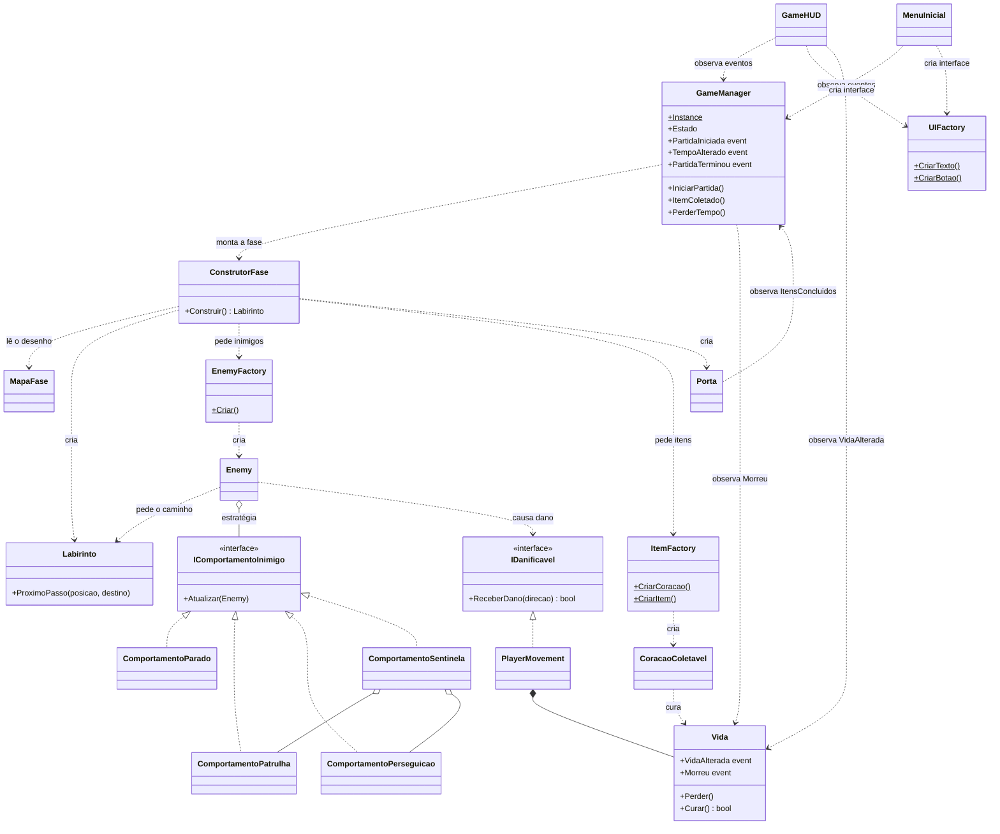
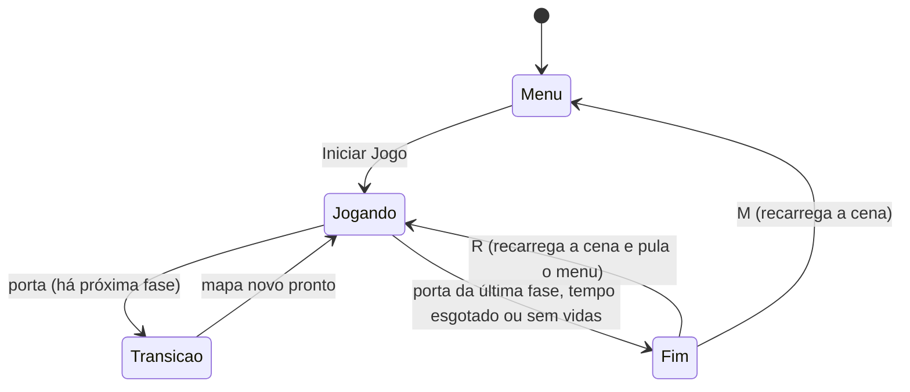

# Jogo Intro

Jogo 2D feito em **Unity 6** em que o jogador controla uma bola e precisa atravessar **dois labirintos**: em cada um, **coletar todos os itens** para abrir a **porta de saída** antes que o tempo acabe, desviando de inimigos.

## Como jogar

Ao abrir o jogo aparece o **menu inicial**, com as opções **Iniciar Jogo** e **Regras**. Os botões funcionam com o mouse ou com as setas + Enter.

| Tecla | Ação |
|---|---|
| **W A S D** ou **setas** | Mover o jogador |
| **R** | Jogar novamente (na tela de fim de partida) |
| **M** | Voltar ao menu (na tela de fim de partida) |

- A partida começa com **45 segundos**, em contagem regressiva.
- Cada item coletado dá **+3 segundos**.
- A **porta** de cada fase começa trancada (marrom) e abre (verde, pulsando) quando todos os itens da fase são coletados. Entrar nela leva à próxima fase (com uma transição: a tela escurece, mostra o nome da fase e clareia no mapa novo) e dá **+30 segundos**. Vida e cronômetro continuam de uma fase para a outra.
- O jogador tem **5 corações**, mostrados no canto superior direito.
- Encostar em um inimigo tira **1 coração e 5 segundos**. O jogador é empurrado e fica invencível (piscando) por 1,5 s.
- **3 corações** espalhados pelo mapa recuperam 1 vida cada. Com a vida cheia eles não são consumidos e ficam no mapa para depois.
- **Vitória:** passar pela porta da última fase. **Derrota:** o tempo chegar a zero ou os corações acabarem.
- Ao final aparece o tempo da partida e o **melhor tempo** (recorde), que fica salvo entre sessões.

### Inimigos

| Comportamento | Descrição |
|---|---|
| **Parado** | Obstáculo imóvel |
| **Patrulha** | Vai e volta em uma direção pré-definida |
| **Perseguição** | Segue o jogador o tempo todo |
| **Sentinela** | Patrulha até o jogador chegar perto, fica laranja e passa a persegui-lo. Volta a patrulhar quando o jogador se afasta |

Os inimigos seguem os corredores do labirinto: o perseguidor e a sentinela encontram o caminho até o jogador sem atravessar paredes.

## Como executar

1. Abra a pasta do projeto no **Unity Hub** (versão 6000.6 ou compatível).
2. Abra a cena `Assets/Scenes/SampleScene`.
3. Clique em **Play**.

O `GameManager`, o menu, a interface e o labirinto são criados automaticamente ao iniciar a cena. Os valores de tempo podem ser ajustados pelo Inspector.

### Editando o labirinto

As fases são desenhos em texto no arquivo `Assets/Scripts/Level/MapaFase.cs`. Cada caractere é uma célula de 0,5 x 0,5 unidade:

| Símbolo | Significado | Símbolo | Significado |
|---|---|---|---|
| `#` | parede | `.` | chão |
| `P` | início do jogador | `I` | item amarelo |
| `C` | coração (vida) | `E` | inimigo parado |
| `H` | patrulha horizontal | `V` | patrulha vertical |
| `S` | sentinela | `F` | perseguidor |
| `D` | porta de saída | | |

Para mudar uma fase, basta redesenhar o texto (todas as linhas com o mesmo tamanho). Para criar uma fase nova, desenhe outro mapa e adicione-o à lista `MapaFase.Fases`: a porta da fase anterior passa a levar até ela. Patrulhas e sentinelas andam de uma parede até a outra no corredor onde foram desenhadas. Os itens já colocados na cena são movidos para as posições `I` da primeira fase; nas seguintes, são criadas cópias deles.

O labirinto só é montado ao dar Play, mas a aba **Scene** mostra uma pré-visualização dele no editor (paredes e marcadores com a letra de cada símbolo). Ela pode ser ligada e desligada no menu **Jogo Intro → Pré-visualizar labirinto**, e **Jogo Intro → Pré-visualizar próxima fase** alterna entre as fases.

## Estrutura do código

Os scripts ficam em `Assets/Scripts/`, organizados **por funcionalidade**: cada pasta reúne tudo de uma parte do jogo.

```
Assets/Scripts/
├── Core/       regras do jogo e contratos usados por várias partes
├── Editor/     ferramentas do editor (não vão para o jogo final)
├── Player/     o jogador
├── Enemies/    os inimigos
├── Items/      os itens coletáveis
├── Level/      o labirinto: desenho, montagem e busca de caminho
└── UI/         as telas e a interface
```

| Pasta | Arquivo | Responsabilidade |
|---|---|---|
| `Core/` | `GameManager.cs` | Regras e estados da partida: cronômetro, contagem regressiva, itens, vidas, vitória/derrota e recorde |
| `Core/` | `Vida.cs` | Pontos de vida (corações) de um objeto |
| `Core/` | `IDanificavel.cs` | Interface para objetos que podem levar dano |
| `Core/` | `ITransicaoFase.cs` | Interface da animação de troca de fase |
| `Core/` | `SpriteFactory.cs` | Sprites gerados por código (quadrado e coração) |
| `Player/` | `PlayerMovement.cs` | Movimento do jogador, coleta de itens e reação a dano |
| `Enemies/` | `Enemy.cs` | Configuração do inimigo e dano ao jogador |
| `Enemies/` | `ComportamentosInimigo.cs` | As formas de movimento dos inimigos |
| `Enemies/` | `EnemyFactory.cs` | Criação de inimigos |
| `Items/` | `CoracaoColetavel.cs` | Item que recupera 1 coração |
| `Items/` | `ItemFactory.cs` | Criação dos corações e itens |
| `Level/` | `MapaFase.cs` | Desenho das fases em texto |
| `Level/` | `ConstrutorFase.cs` | Monta a fase a partir do desenho (paredes, jogador, itens, corações, porta e inimigos) |
| `Level/` | `Porta.cs` | Porta de saída: abre quando os itens acabam e leva à próxima fase |
| `Level/` | `Labirinto.cs` | Grade do labirinto e busca de caminho (BFS) para os inimigos |
| `Editor/` | `PreviewFase.cs` | Pré-visualização do labirinto na aba Scene |
| `UI/` | `MenuInicial.cs` | Menu inicial (Iniciar Jogo / Regras) |
| `UI/` | `GameHUD.cs` | Interface durante a partida (tempo, itens, corações, tela final) |
| `UI/` | `TransicaoFase.cs` | Animação de troca de fase (escurecer, cartão "Fase N", clarear) |
| `UI/` | `UIFactory.cs` | Criação dos elementos de interface (canvas, textos, painéis, botões) |

## Design patterns



### Singleton (`GameManager`)

Existe um único `GameManager`, acessível de qualquer script por `GameManager.Instance`. Assim o jogador e os inimigos avisam o jogo sobre itens coletados e dano sem precisar guardar uma referência. Se um segundo `GameManager` aparecer, ele é destruído no `Awake`.

### Observer (`GameManager` e `Vida` → interface)

O `GameManager` não altera a tela diretamente. Ele dispara eventos:

- `PartidaIniciada`: o jogador saiu do menu e a partida começou;
- `TempoAlterado(float variacao)`: um bônus (positivo) ou uma penalidade (negativa);
- `ItensConcluidos`: todos os itens da fase foram coletados;
- `FaseIniciada(int fase)`: o jogador entrou em uma nova fase;
- `PartidaTerminou(ResultadoPartida resultado)`: o fim da partida, com os dados para a tela final.

O `MenuInicial`, o `GameHUD` e a `Porta` se inscrevem nesses eventos: o menu se esconde quando a partida começa, o HUD aparece e mostra mensagens ("A porta abriu!", "Fase 2"), e a porta abre quando os itens acabam. As regras do jogo não dependem da interface, que pode ser trocada sem mexer no `GameManager`.

O componente `Vida` segue a mesma ideia, com dois eventos:

- `VidaAlterada(atual, maxima)`: o `GameHUD` redesenha os corações (cheios ou vazios);
- `Morreu`: o `GameManager` encerra a partida com o motivo "sem vidas".

Nem o jogador nem os inimigos sabem que o HUD ou o `GameManager` existem: o inimigo só causa dano, o jogador só perde um coração, e cada interessado reage ao evento.

### Máquina de estados (`GameManager`)

A partida está sempre em um de quatro estados (`EstadoJogo`):



Cada estado define o que o `Update` faz e quais ações valem. Por exemplo, coletar itens ou perder tempo só tem efeito no estado `Jogando`. Nos estados `Menu`, `Transicao` e `Fim` o jogo fica congelado (`Time.timeScale = 0`).

### Strategy (comportamentos dos inimigos)

Cada forma de movimento é uma classe que implementa `IComportamentoInimigo`. O `Enemy` não sabe *como* se mover: ele escolhe a estratégia conforme a opção do Inspector e chama `Atualizar()` a cada frame de física.

A `ComportamentoSentinela` é **composta** pelas estratégias de patrulha e perseguição e só decide qual delas usar. Para criar um comportamento novo, basta escrever uma classe nova e registrá-la em `Enemy.CriarEstrategia()`, sem alterar as existentes.

### Null Object (`ComportamentoParado`)

O inimigo parado também tem uma estratégia: uma que não faz nada. Com isso o `Enemy` sempre tem uma estratégia válida e não precisa checar `null`.

### Factory (`EnemyFactory`)

A montagem de um inimigo (criar o objeto, posicionar, escalar e configurar o comportamento) fica em um só lugar. O `ConstrutorFase` só diz qual inimigo quer e onde, sem conhecer os detalhes.

### Factory (`ItemFactory`)

Como a `EnemyFactory`, concentra a criação dos corações de vida e dos itens amarelos.

### Factory (`UIFactory` e `SpriteFactory`)

O menu e o HUD montam a interface por código usando a mesma fábrica: `CriarCanvas`, `CriarPainel`, `CriarTexto`, `CriarImagem` e `CriarBotao`. Isso evita repetir o código de criação e garante o mesmo visual (fonte, contorno, cores dos botões) nas duas telas.

A `SpriteFactory` gera os sprites do jogo por código (o quadrado dos inimigos e o coração usado no HUD e nos itens). Cada sprite é criado uma única vez e reaproveitado, então o jogo não depende de arquivos de imagem.

### Builder (`ConstrutorFase`)

A fase é descrita como dados (o texto do `MapaFase`) e montada passo a passo pelo `ConstrutorFase`: grade, paredes, jogador, itens, corações e inimigos. O Builder decide **o que** vai em cada lugar e delega **como** criar cada objeto às fábricas. Assim, mudar o labirinto não exige mexer em código, só no desenho.

Ao montar as paredes, células vizinhas são agrupadas em retângulos maiores. Isso gera menos objetos e evita que o jogador "enganche" nas emendas entre paredes.

### Busca em largura (`Labirinto`)

Os inimigos são movidos por código (kinematic), então a física não os impede de atravessar paredes. Por isso o `Enemy.MoverPara()` pede ao `Labirinto` o próximo ponto do caminho, calculado com uma **busca em largura (BFS)** na grade. Como todas as estratégias de movimento passam por `MoverPara()`, todas respeitam as paredes sem nenhuma alteração nelas. Antes de cada curva, o inimigo se alinha com o centro da célula, para não cortar os cantos das paredes.

### Interface `ITransicaoFase` (troca de fase)

A troca de fase é uma corrotina do `GameManager` com três etapas: **escurecer → trocar o mapa → clarear**. O `GameManager` decide *quando* cada etapa acontece, mas a animação em si fica com quem implementa `ITransicaoFase` (a `TransicaoFase`, que faz o fade e mostra o cartão "Fase N"). Como o `GameManager` depende só da interface, a animação pode ser trocada sem mexer nas regras; sem nenhuma implementação, a troca continua funcionando, só que instantânea.

### Responsabilidade única (`Vida`)

A vida não fica dentro do `PlayerMovement`: é um componente próprio, que só cuida de perder, curar e avisar. O `CoracaoColetavel` cura qualquer objeto que tenha `Vida`, sem conhecer o jogador.

### Interface `IDanificavel`

Os inimigos causam dano a qualquer objeto que implemente `IDanificavel`, e não diretamente ao `PlayerMovement`. Isso reduz o acoplamento e permite que outros objetos levem dano no futuro sem alterar o `Enemy`.
