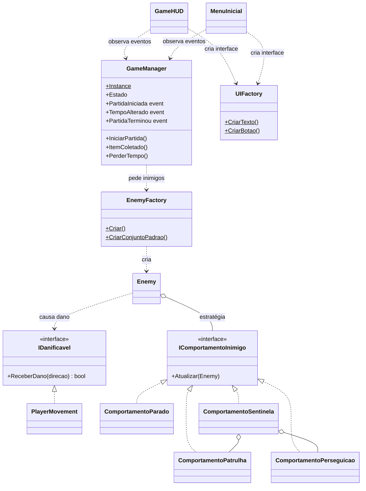
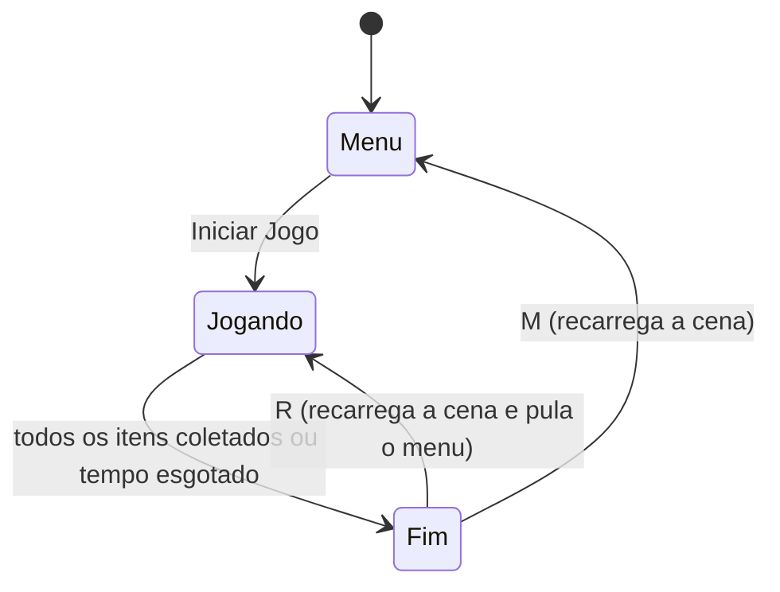

# Jogo Intro

Jogo 2D feito em **Unity 6** em que o jogador controla uma bola dentro de uma arena e precisa **coletar todos os itens antes que o tempo acabe**, desviando de inimigos.

## Como jogar

Ao abrir o jogo aparece o **menu inicial**, com as opções **Iniciar Jogo** e **Regras**. Os botões funcionam com o mouse ou com as setas + Enter.

| Tecla | Ação |
|---|---|
| **W A S D** ou **setas** | Mover o jogador |
| **R** | Jogar novamente (na tela de fim de partida) |
| **M** | Voltar ao menu (na tela de fim de partida) |

- A partida começa com **30 segundos**, em contagem regressiva.
- Cada item coletado dá **+3 segundos**.
- Encostar em um inimigo tira **5 segundos**. O jogador é empurrado e fica invencível (piscando) por 1,5 s.
- **Vitória:** coletar todos os itens. **Derrota:** o tempo chegar a zero.
- Ao final aparece o tempo da partida e o **melhor tempo** (recorde), que fica salvo entre sessões.

### Inimigos

| Comportamento | Descrição |
|---|---|
| **Parado** | Obstáculo imóvel |
| **Patrulha** | Vai e volta em uma direção pré-definida |
| **Perseguição** | Segue o jogador o tempo todo |
| **Sentinela** | Patrulha até o jogador chegar perto, fica laranja e passa a persegui-lo. Volta a patrulhar quando o jogador se afasta |

Se a cena não tiver inimigos, um conjunto com um inimigo de cada tipo é criado automaticamente.

## Como executar

1. Abra a pasta do projeto no **Unity Hub** (versão 6000.6 ou compatível).
2. Abra a cena `Assets/Scenes/SampleScene`.
3. Clique em **Play**.

O `GameManager`, o menu e a interface são criados automaticamente ao iniciar a cena. Os valores de tempo e o comportamento de cada inimigo podem ser ajustados pelo Inspector.

## Estrutura do código

Os scripts ficam em `Assets/Scripts/`, organizados **por funcionalidade**: cada pasta reúne tudo de uma parte do jogo.

```
Assets/Scripts/
├── Core/       regras do jogo e contratos usados por várias partes
├── Player/     o jogador
├── Enemies/    os inimigos
└── UI/         as telas e a interface
```

| Pasta | Arquivo | Responsabilidade |
|---|---|---|
| `Core/` | `GameManager.cs` | Regras e estados da partida: cronômetro, contagem regressiva, itens, vitória/derrota e recorde |
| `Core/` | `IDanificavel.cs` | Interface para objetos que podem levar dano |
| `Player/` | `PlayerMovement.cs` | Movimento do jogador, coleta de itens e reação a dano |
| `Enemies/` | `Enemy.cs` | Configuração do inimigo e dano ao jogador |
| `Enemies/` | `ComportamentosInimigo.cs` | As formas de movimento dos inimigos |
| `Enemies/` | `EnemyFactory.cs` | Criação de inimigos |
| `UI/` | `MenuInicial.cs` | Menu inicial (Iniciar Jogo / Regras) |
| `UI/` | `GameHUD.cs` | Interface durante a partida (tempo, itens, tela final) |
| `UI/` | `UIFactory.cs` | Criação dos elementos de interface (canvas, textos, painéis, botões) |

## Design patterns



### Singleton (`GameManager`)

Existe um único `GameManager`, acessível de qualquer script por `GameManager.Instance`. Assim o jogador e os inimigos avisam o jogo sobre itens coletados e dano sem precisar guardar uma referência. Se um segundo `GameManager` aparecer, ele é destruído no `Awake`.

### Observer (`GameManager` → `GameHUD`)

O `GameManager` não altera a tela diretamente. Ele dispara eventos:

- `PartidaIniciada`: o jogador saiu do menu e a partida começou;
- `TempoAlterado(float variacao)`: um bônus (positivo) ou uma penalidade (negativa);
- `PartidaTerminou(ResultadoPartida resultado)`: o fim da partida, com os dados para a tela final.

O `MenuInicial` e o `GameHUD` se inscrevem nesses eventos: o menu se esconde quando a partida começa, e o HUD aparece e atualiza a interface. As regras do jogo não dependem da interface, que pode ser trocada sem mexer no `GameManager`.

### Máquina de estados (`GameManager`)

A partida está sempre em um de três estados (`EstadoJogo`):



Cada estado define o que o `Update` faz e quais ações valem. Por exemplo, coletar itens ou perder tempo só tem efeito no estado `Jogando`. Nos estados `Menu` e `Fim` o jogo fica congelado (`Time.timeScale = 0`).

### Strategy (comportamentos dos inimigos)

Cada forma de movimento é uma classe que implementa `IComportamentoInimigo`. O `Enemy` não sabe *como* se mover: ele escolhe a estratégia conforme a opção do Inspector e chama `Atualizar()` a cada frame de física.

A `ComportamentoSentinela` é **composta** pelas estratégias de patrulha e perseguição e só decide qual delas usar. Para criar um comportamento novo, basta escrever uma classe nova e registrá-la em `Enemy.CriarEstrategia()`, sem alterar as existentes.

### Null Object (`ComportamentoParado`)

O inimigo parado também tem uma estratégia: uma que não faz nada. Com isso o `Enemy` sempre tem uma estratégia válida e não precisa checar `null`.

### Factory (`EnemyFactory`)

A montagem de um inimigo (criar o objeto, posicionar, escalar e configurar o comportamento) fica em um só lugar. O `GameManager` só chama `EnemyFactory.CriarConjuntoPadrao()`, sem conhecer os detalhes.

### Factory (`UIFactory`)

O menu e o HUD montam a interface por código usando a mesma fábrica: `CriarCanvas`, `CriarPainel`, `CriarTexto` e `CriarBotao`. Isso evita repetir o código de criação e garante o mesmo visual (fonte, contorno, cores dos botões) nas duas telas.

### Interface `IDanificavel`

Os inimigos causam dano a qualquer objeto que implemente `IDanificavel`, e não diretamente ao `PlayerMovement`. Isso reduz o acoplamento e permite que outros objetos levem dano no futuro sem alterar o `Enemy`.
